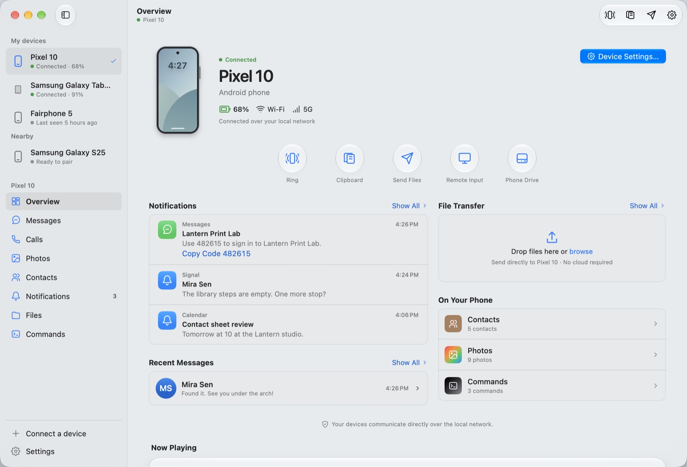
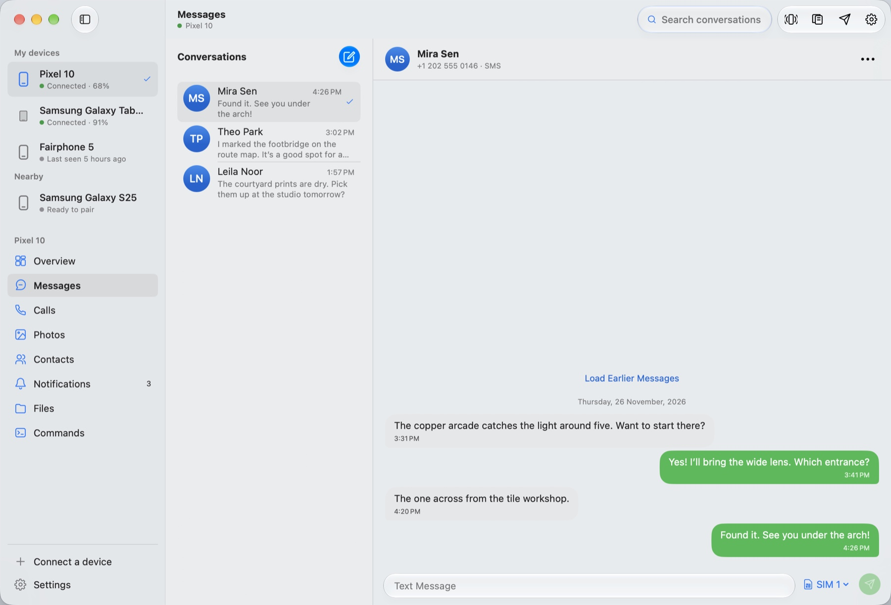
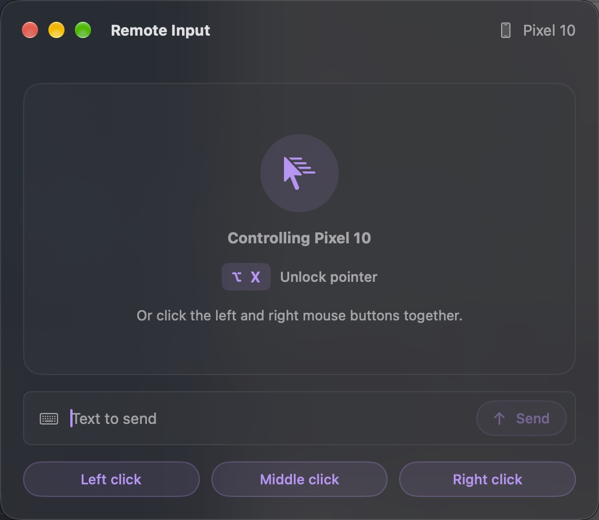

# Nearo

**Your Android, on your Mac.** Read a conversation, bring a photo into Finder, or use your Mac’s trackpad to scroll on your phone. Nearo is a native Swift and SwiftUI app for macOS 15 and later, with separate builds for Apple Silicon and Intel.



[Download for Apple Silicon](https://github.com/anwarulislam/nearo/releases/latest/download/Nearo-AppleSilicon.dmg) · [Download for Intel](https://github.com/anwarulislam/nearo/releases/latest/download/Nearo-Intel.dmg) · [Browse the feature gallery](https://anwar.bd/nearo/gallery)

Nearo’s first public version is **1.0.0**. It checks daily for stable updates. Choose **Install and Relaunch** when you’re ready, or use **Check for Updates** to check immediately.

## Pair your first device

1. Install the Nearo disk image for your Mac’s processor and drag **Nearo.app** into Applications. To make a local disk image from this checkout, run `scripts/release.sh`. The Apple Silicon and Intel images appear in `dist/`.
2. On Android, open Nearo for Android or KDE Connect. KDE Connect is available on [Google Play](https://play.google.com/store/apps/details?id=org.kde.kdeconnect_tp) and [F-Droid](https://f-droid.org/packages/org.kde.kdeconnect_tp/).
3. Put both devices on the same Wi-Fi network. Request pairing from either device, compare the verification codes, and accept. Select the phone in Nearo to open its Overview.

## What you can do

| On your Mac | With your phone |
| --- | --- |
| **Messages and contacts** | Pick up an SMS thread or start one from a contact. Choose the sending SIM on supported dual-SIM phones. |
| **Notifications and calls** | Reply from a supported banner, copy a verification code, silence an incoming call, or review call history. Earlier call history uses Bluetooth phonebook access. |
| **Files and photos** | Browse phone storage in Finder, send items from the Share menu, or save photos from the gallery. Received shares default to `~/Downloads`. Choose a folder for each phone in **Settings → Devices**. |
| **Remote Input** | Open **Overview → Remote Input** to move, click, scroll and send text to Android. Press **Option‑X** to unlock the pointer. You can also use the phone as a trackpad, keyboard or presentation remote for the Mac. |
| **Media and clipboard** | Control playback and volume, share text between devices, or ring a misplaced phone. |
| **Widgets and controls** | Pin a device to a desktop widget or follow the selected phone. Add Nearo’s actions in Control Center on macOS 26. |
| **Browser workspace** | In **Settings → General → Web access**, open the private workspace in a browser on the same Mac. |

<p> </p>

[Full feature and screenshot inventory](docs/features.md) · [Setup and troubleshooting](https://anwar.bd/nearo/guide) · [Roadmap](ROADMAP.md)

## Size and performance

| Prelaunch measurement | Download (DMG) | Installed app¹ |
| --- | ---: | ---: |
| Apple Silicon | 4.87 MB | 7.96 MB |
| Intel | 5.07 MB | 8.06 MB |

¹ Sum of regular-file sizes in the signed app bundle, in decimal MB.

On an M1 Pro running macOS 27.0.1, the Release app averaged **0.80% of one CPU core** and **39.0 MiB median resident memory** over a 60-second offline idle sample. The app was unpaired, its main window was open, and networking was isolated. [Machine, conditions, and measurement method](docs/performance.md)

## Connections and permissions

Nearo connects directly to paired devices over a reachable network. Use Wi-Fi, connect by address, or enable discovery across your Tailscale network. Bluetooth transport is available as a beta option. Pairing pins the peer certificate. Update checks contact GitHub.

Grant Android permissions for the features you use. On the Mac, Notifications enables banners and Accessibility lets your phone operate the Mac pointer and keyboard. Browser access is optional and off by default. Commands run under your Mac account and are configured in the Commands pane.

## Build from source

Open `Nearo.xcodeproj` in Xcode 26 or later, or run these commands from the checkout on a Mac:

```sh
scripts/dev.sh --build-only
scripts/dev.sh
```

The first command builds and verifies the Debug bundle. The second launches the app. Use `scripts/dev.sh -NearoDemoData` for a sample-data session.

## Credits

Created by [Anwarul Islam](https://github.com/anwarulislam). Nearo is independent of the KDE project and uses the KDE Connect protocol. See the [project license](LICENSE) and [MediaRemoteAdapter license](Vendor/MediaRemoteAdapter/LICENSE).
